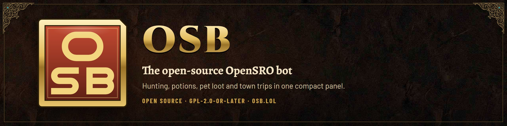

# OSB

OSB (OpenSROBot) is an open-source OpenSRO bot: hunting, potions, pet loot and automatic town trips. It is maintained by Corevider and published at [github.com/corevider/osb](https://github.com/corevider/osb).

**[Install](https://raw.githubusercontent.com/corevider/osb/main/osb.user.js)** with Violentmonkey or Tampermonkey (disable any other OpenSRO bot, including the previous bot), then reload the game. It checks for updates itself. Each [release](https://github.com/corevider/osb/releases/latest) also has `osb.user.js` and `osb.meta.js` as files.

Guides, screenshots and the changelog are on [osb.lol](https://osb.lol). To run several accounts side by side, use [OSB Manager](https://github.com/corevider/osb-manager) (Windows and macOS), which loads OSB in every game window.

Coming from the previous bot? Your settings carry over, and share codes and files made by it still import. Disable the old script first: two bots cannot run in one tab.

**Safari (macOS):** Violentmonkey has no Safari version. Install the free [Userscripts](https://apps.apple.com/app/userscripts/id1463298887) app (or Tampermonkey for Safari), enable it under Safari > Settings > Extensions, then open the install link above. Safari support is untested: keep the game tab visible, because Safari throttles background tabs and the bot can stall. Needs Safari 15.4 or later. iPhone and iPad are not supported, since iOS suspends the page when you leave Safari.

## Start

1. **Combat:** save your hunting spot, pick attack skills, buffs, imbue.
2. **Loot:** choose what to collect. Summon your pickup pet and set it as collector.
3. **Supplies:** set HP/MP potion thresholds.
4. **F8** starts and stops.

The **Setup** page checks all this for you and fixes the next missing thing.

## Features

- Combat rotation, buffs with weapon swapping, imbue, party heal/buff, resurrection
- Pet and character looting with per-item rules (pick, store, sell, keep, drop)
- Optional pickup-pet slot balancing, and a primary/secondary weapon and shield that are never sold, stored or dropped
- Town trips by return scroll: potions, repair, warehouse, selling, reverse back
- Optional selling of ordinary gear from the character bag on town trips (off by default)
- Item alchemy, auto mastery and skills, stat points
- Auto trade: buy specialty goods in one town, walk to another and sell them (needs a trader suit and a transport)
- Automatic reconnect, optional start on entering the game, walk-back after death, anti-stuck, obstacle detours
- Minimap, session stats, wardrobe, share and import settings

Settings are saved per character.

## Keys

| Key | Action |
| --- | --- |
| **F8** | Start / stop |
| **F6** | Minimise to an icon / bring the panel back |
| **F7** | Fold panel (brings a minimised one back) |
| **Shift+F7** | Hide / show panel |
| **×** | Minimise to an icon, bot keeps running |

## More

- [Full manual](docs/manual.md)
- [Obstacle recovery](OBSTACLE-RECOVERY.md)
- Help, suggestions, bug reports: [GitHub issues](https://github.com/corevider/osb/issues). **Settings → Send bug report** prepares a report you can copy or save, or send to the OSB team after a confirmation.
- [Maintaining OSB](docs/MAINTAINING.md): secrets, branch protection, releases and upstream ports
- [Security](SECURITY.md): how to report a vulnerability privately, and how the Claude tokens of the automation are kept safe

## Privacy

OSB sends nothing about you to anyone unless you say so. The bot talks to the game page, and it fetches only update information and navigation data from `raw.githubusercontent.com/corevider/osb` and `api.github.com`. Those requests carry no data about you or your game. The update check (about every 15 minutes) is on by default and can be switched off under **Settings → Privacy → Check GitHub for OSB updates**; when it is off, OSB makes no update request at all and you update by hand. Two features can send data to the OSB team at `api.osb.lol`, and both are off until you act:

- **Share usage statistics** (Settings → Privacy, off by default): a short status report about every 10 minutes, linked to a random install ID. You can see exactly what is sent, download it, or delete it from the server at any time. A second switch adds your character names. Inside OSB Manager, OSB sends none of this itself.
- **Send** in the report window: one report you have previewed, after you confirm. Without usage statistics it is anonymous.

No other host receives data. Details, the list of requests and what is never sent: [docs/telemetry.md](docs/telemetry.md). Privacy contact: privacy@osb.lol.

## Review policy

OSB takes changes from outside only after review:

- Pull requests from the maintainers are reviewed automatically. Any other pull request is reviewed by the automatic reviewer only after a maintainer adds the label `ok-to-review`.
- Nothing is merged without an approving review by a maintainer and a passing build and test run. The automatic reviewer only comments; it cannot approve or merge.
- Upstream changes are ported by hand. A weekly check opens an issue that lists the new commits, and the port is reviewed like any other pull request.

## Credits and license

OSB is a fork of [opensro-bot-lean](https://github.com/nixxane/opensro-bot-lean), which was adapted from TSK's OpenSRO Assistant. GPL-2.0-or-later. Copyright nixxane, Corevider and the contributors. See [LICENSE](LICENSE).
